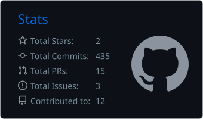
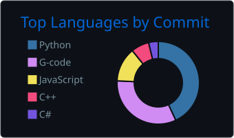

<!-- Header -->

  

  

  

> *"A day without learning is a day wasted. You need to make mistakes to learn new things."*

## 👋 About me

- 🎓 3rd-year Bachelor's student **ICT-Electronics** at **VIVES University of Applied Sciences**, Bruges
- 🔧 Working on a **LAN party for 70 students**: network design, monitoring and a tournament portal
- 📡 Into **IoT, networking, embedded hardware and AI**
- 🏎️ Off the keyboard: sim racing, sports, martial arts and movies

## 🛠️ Tech stack

**Languages**

  

**Embedded & hardware**

  
  &nbsp;
  
  
  

**Apps, AI & infrastructure**

  
  &nbsp;
  

## 🚀 Projects

### 🎮 VIVES LAN-portaal
Tournament portal for our LAN party: live brackets on the projector, seat map, prizes and Discord notifications.
Supports single & double elimination, round robin, groups + knock-out, Swiss and points-based battle royale.
Runs in one Docker container and works fully offline on the LAN.

<table>
  <tr>
    <td width="50%" valign="top">
      <h3><a href="https://github.com/vives-project-xp/Signapse">🤟 Signapse</a></h3>
      Real-time sign language translation to text and speech with smart glasses, computer vision and machine learning.
        
      
      
      
      
      
    </td>
    <td width="50%" valign="top">
      <h3><a href="https://github.com/kyell182/pi-hardwaretest">🍓 Pi hardware test</a></h3>
      One SD card you move from Pi to Pi. On every boot it tests the hardware of a Raspberry Pi 4 or 5 and writes a report, no screen or keyboard needed.
        
      
      
      
    </td>
  </tr>
  <tr>
    <td width="50%" valign="top">
      <h3><a href="https://github.com/kyell182/project-3---lanparty-26">🌐 LAN party 2026</a></h3>
      Designing and organising a safe, inclusive LAN party for students: network design for 70 players, a Docker monitoring stack, risk analysis and a runbook.
        
      
      
      
    </td>
    <td width="50%" valign="top">
      <h3><a href="https://github.com/kyell182/samenvattingen">📚 Study notes</a></h3>
      Summaries, cheat sheets and lab reports from ICT-Electronics, organised per year and course (in Dutch). Plus a <a href="https://github.com/kyell182/cheat-sheet-translated">Dutch Cisco CCNA cheat sheet</a>.
        
      
      
    </td>
  </tr>
</table>

## 📊 GitHub stats

  
  

  

  <picture>
    <source media="(prefers-color-scheme: dark)" srcset="https://raw.githubusercontent.com/kyell182/kyell182/output/snake-dark.svg">
    
  </picture>

<!-- Footer -->

  

